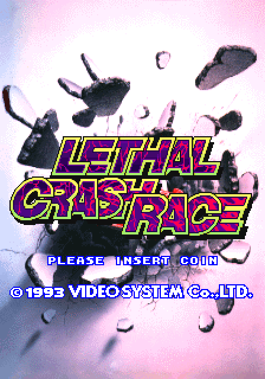
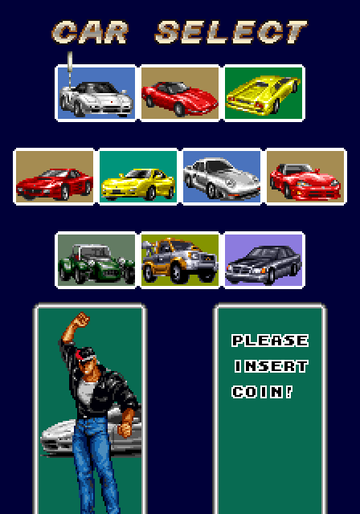
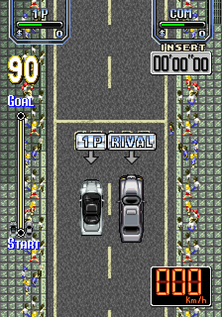

# Lethal Crash Race for MiSTer

A MiSTer FPGA core for **Lethal Crash Race / Bakuretsu Crash Race** (Video System, 1993), the top-down kart racer: a 68000, a Z80
with a YM2610, a char layer, a K053936 rotating / zooming layer and the VS9108 / VS9210 sprite chips. Written from MAME 0.289's
driver (`src/mame/vsystem/crshrace.cpp`, with `vsystem_spr.cpp`, `k053936.cpp` and the devices it uses), with MAME as the reference
for everything; the platform layer follows the owner's Aquarium core.

  
  
  

The title screen, the car select and a race's start as the core draws them (the system bench, `sim/run_sys.sh`, turned upright as
the Orientation option shows it; doubled). All three are pixel-identical to MAME's frames.

No ROMs are in this repository; you supply your own MAME `crshrace.zip`.

**Status.** Simulated with the game's real programs and compared with MAME 0.289 (see "What is verified"); built with Quartus 17.0
(38 % of the ALMs, 434 of 553 M10K blocks, 44 DSPs; the timing met at 96 MHz with 0.30 ns of setup and 0.25 ns of hold slack, and
on the HDMI clock). **Release 20261028. Not yet tested on a real MiSTer.**

## Install

1. Unzip `LethalCrashRace_MiSTer_<date>.zip` (`tools/package.py` writes it to `dist/`) over the root of the SD card (`/media/fat/`): the
   core goes to `_Arcade/cores/`, `Lethal Crash Race (set 1).mra` to `_Arcade/` and set 2's two MRAs to
   `_Arcade/_alternatives/_Crash Race/`. (By hand from the repository: `releases/crashrace_<date>.rbf` to `_Arcade/cores/`, the
   contents of `mra/` to `_Arcade/`. Keep the RBF's `crashrace_` name: MiSTer finds the core by the MRA's `<rbf>`.)
2. Put your MAME 0.289 `crshrace.zip` (the merged set holds all three versions) in `/media/fat/games/mame/`.
3. Start `Lethal Crash Race (set 1)` (or a set 2 MRA) from the Arcade menu. A recent Main_MiSTer copies the 12.6 MB image to the
   DDR3 in one go (the MRAs' `address=`, the fast load) and the core reads it from there; an older one streams it.

| Set | MRA |
|---|---|
| `crshrace` | Lethal Crash Race (set 1) |
| `crshrace2` | Lethal Crash Race (set 2) |
| `crshrace2a` | Lethal Crash Race (set 2, alternate sound ROM) |

## Controls and OSD

An 8-way joystick and two buttons per player, Start and Coin, named for what they do: **Accel** (MAME's button 1) and **Brake**
(button 2). Keyboard: 1 / 2 start, 5 / 6 / 7 coin, 9 service, T tilt, F1 test.

| Option | Values |
|---|---|
| Aspect ratio | Original (3:4 turned, 4:3 with Orientation Horz), Full Screen, [ARC1], [ARC2] |
| Orientation | Vert (the default): the vertical game turned upright for HDMI through a frame buffer in the DDR3 (the framework's `screen_rotate`); Horz: as the board makes it, for a monitor on its side. The analog output is always the board's |
| Scale | Normal, V-Integer, HV-Integer, Narrower HV-Integer, HV-Integer+ (the framework's integer scaling for HDMI) |
| Scandoubler Fx | None, HQ2x, CRT 25 / 50 / 75 % |
| CRT Adjust (page) | Off, On; H-Size 0, +1 and -16 to -1, H-Position, V-Shift -16 to +15: rmonic79's CRT Adjust (`modules/crt-adjust`) for a 15 kHz analog output, the picture moved and sized through a line buffer while the sync keeps its timing. The position stops where the picture would reach into the hsync pulse or past the line's end. It does nothing while the scandoubler is on (31 kHz) |
| Flip Screen | Off, On: the picture turned 180 degrees by the core's renderer (analog and HDMI alike). It is not applied while the Service Mode is on: the test screens are drawn for the upright cabinet. The game's own Flip Screen DIP switch stays Off |
| DIP switches | MAME's: Demo Sounds, Free Play, Difficulty, Coin Slot, Coin A, Coin B, 2 to Start 1 to Continue, Reset on P.O.S.T. Error, Region |
| Service Mode | Off, On: the board's service switch (SW2:4). The game looks at it when it starts: set it, then Reset |
| Volume | Normal, -6 dB, -12 dB, +6 dB |
| Audio | Stereo, Mono |
| Swap stereo | No, Yes |

The video is MAME's 320 x 224 picture on a standard 15 kHz 240p raster of the core's own: 263 lines of 406 dots at a 6.4 MHz dot
(15.76 kHz, 59.94 Hz), every line the same, the picture with 39 blank lines; what a RetroTINK 4K takes as "MiSTer 240p". MAME's
screen gives no blanking times for this board (`docs/hardware.md`, "The core's timing").

## What is verified

| | |
|---|---|
| ROM image | `tools/make_mra.py crshrace.zip` assembles all three MRAs' images (`tools/mra_build.py`, the MiSTer MRA rules, the md5 as MiSTer computes it) and compares them with the image `tools/crshrace_rom.py` builds by MAME's loading rules: identical |
| Whole machine | `sim/run_sys.sh`: the 68000 and the Z80 running the game's programs, the 12.6 MB ROM image downloaded through the loader into the SDRAM controller and a behavioural SDRAM (which checks its timing: no violation), the video, the YM2610. Against MAME 0.289 (`tools/lua/snap.lua`, `probe.lua`; `tools/cmp_frames.py`): **pixel-identical** with no inputs at the power-on test and the attract mode (the Video System logo, the K053936 zoom of the title at frames 580, 600, 620 and 640, the title screen), and with MAME's scripted inputs (`SCHED=play`: a coin, start, Accel held, steering) at the credited title screen, the car select, the stage map and a race's start (frames 650, 900, 1,100 and 1,300). The 68000's sound commands come in the same frames as MAME's |
| Flip Screen | `+FLIP`: the picture at frame 580 is the unflipped one turned 180 degrees, dot for dot (`tools/cmp_frames.py --rot180`) |
| Sound | The bench's sound (`AUDIO=1`, 48 kHz stereo) against MAME's recording, the loudness second by second: the same from the sixth second on; seconds 1-5 of the attract music some 25 % quieter (below) |
| Lint | Verilator `-Wall` (`sim/lint.sh`): only width and unused-bit warnings in the core's own RTL |

The MiSTer top level (`CrashRace.sv`: the framework's video path, `screen_rotate`, CRT Adjust, the fast load) is built and timed
but not simulated, and nothing has run on a real MiSTer yet.

## Where the core is not MAME

* **The frame rate.** 59.94 Hz on the core's 263-line raster, not MAME's 60.00 (MAME's screen is a placeholder of 512 x 256
  without blanking times): the game runs 0.1 % slower.
* **The frame labels.** In some stretches MAME's frame count runs one ahead of the bench's (the bench's frame f is MAME's f + 1,
  as in the Aquarium core); the comparisons take that into account (`cmp_frames.py --lag 1`). The pictures and the order of the
  sound commands are MAME's.
* **Flip Screen.** MAME does not flip this game (`MACHINE_NO_COCKTAIL`); the core turns MAME's picture 180 degrees. Where the
  board puts its flipped picture is not known.
* **The YM2610 is jt10**, not MAME's ymfm. The SSG's mix level is the likely cause of the first seconds' quieter sound; it is
  still to be checked against ymfm.
* **Button 3.** MAME lists a third button per player that the game does not appear to use; the core leaves it released.

## Repository layout

| Path | |
|---|---|
| `CrashRace.sv`, `CrashRace.q*`, `CrashRace.sdc`, `files.qip` | the MiSTer top level (`emu`), Quartus project, timing constraints |
| `rtl/` | the machine: `crshrace_core` (the 68000's bus, its memories, I/O, the IRQ, the start), `crshrace_video` (the video memories and their vblank snapshot, the raster, the mix, the palette) with `crshrace_chars` (the char layer), `crshrace_roz` (the K053936 layer) and `crshrace_sprites`, `crshrace_sound` (the Z80, the latch, jt10 and its ADPCM ROMs, the mix), `crshrace_cache` (the CPUs' ROM caches), `crshrace_ram`; the platform: `crshrace_sdram`, `crshrace_loader`, `crshrace_fastload` |
| `modules/` | vendored: fx68k (with two local changes), tv80 (the Hexion core's changes), jt12 / jt10 and jt49, rmonic79's CRT Adjust (`modules/VENDOR.md`) |
| `sys/` | the MiSTer framework |
| `mra/` | the MRAs (`tools/make_mra.py`) |
| `sim/` | Verilator benches: the whole machine (`run_sys.sh`: +FLIP, the sound command log +SNDLOG, +IRQLOG, +VLOG, the frame offset +LAG; `SCHED`, `AUDIO`, `SNAPEVERY`, `SNAPFRAMES`), lint |
| `tools/` | ROM image builder (`crshrace_rom.py`), MRA writer and builder, MAME's Lua scripts (`lua/`), picture comparison (`cmp_frames.py`), PPM to PNG, release zip (`package.py`) |
| `docs/` | `hardware.md`: the hardware as MAME describes it and as the core implements it; `images/` |
| `releases/` | the released RBF with its fitter and timing summaries; `dist/` its release notes (the SD card zip is built there, not committed) |

## Building

Quartus Prime Lite 17.0:

    quartus_sh --flow compile CrashRace

Copy `output_files/CrashRace.rbf` to `releases/crashrace_<YYYYMMDD>.rbf` (a later build of the same day: `<YYYYMMDD>b`, ...);
`python3 tools/package.py` then writes the SD card zip (`dist/LethalCrashRace_MiSTer_<YYYYMMDD>.zip`).

The benches need Verilator 5 (in WSL), Python 3 and your romset:

    python3 tools/make_mra.py crshrace.zip                                        # the MRAs, checked against crshrace_rom.py
    python3 tools/crshrace_rom.py crshrace.zip crshrace crshrace.rom
    SNAPFRAMES=580,620,640 sim/run_sys.sh /full/path/crshrace.rom 650 out/a        # attract mode, no inputs
    SCHED=play SNAPFRAMES=650,900,1100,1300 AUDIO=1 sim/run_sys.sh /full/path/crshrace.rom 1310 out/b
    SNAPFRAMES=580 sim/run_sys.sh /full/path/crshrace.rom 590 out/f +FLIP
    SNAPS=581,621,641 LAST=650 mame crshrace -autoboot_script tools/lua/snap.lua -snapshot_directory ref -nothrottle
    python3 tools/cmp_frames.py --lag 1 ref out/a; python3 tools/cmp_frames.py --rot180 out/a out/f 580
    sim/lint.sh

`tools/lua/probe.lua` plays the same inputs as `SCHED=play` in MAME (and logs the video register writes, `PROBEOUT`).
MAME's captures, the images and the benches' pictures go to a scratch folder `work/` next to the repository (never committed).

## Credits

* **MAME**: the crshrace driver (Nicola Salmoria), the Video System sprite device (Nicola Salmoria, David Haywood), the K053936 (David Haywood), the generic latch,
  ymfm (Aaron Giles), the 68000 and the Z80; the hardware knowledge and the reference for every comparison.
* **Jorge Cwik**: fx68k (GPL-3.0-or-later).
* **Guy Hutchison**: tv80 (MIT), with its clock-enable wrapper from plasticbugs/punchout.
* **Jose Tejada (jotego)**: jt12 / jt10 and jt49 (GPL-3.0-or-later).
* **rmonic79 (Umberto Parisi)**, with Andrea Bogazzi (asturur): CRT Adjust (GPL-3.0-or-later).
* The owner's Aquarium core: the platform layer, the owed-cycle scheme, the benches and tools; through it the Rabbit core (the
  SDRAM controller and model, the fast load, the program cache), the Hexion core (tv80 with its changes) and the Gunpey core (the
  MRA md5 rule, the release packaging).
* The MiSTer framework (Sorgelig and contributors).

## Licence

GPL-3.0-or-later (`LICENSE`); vendored modules keep their own licences.
